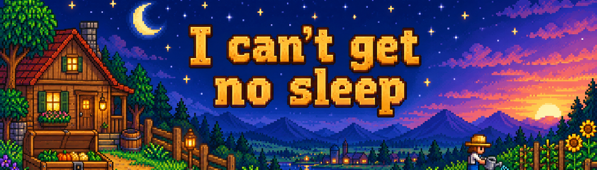

# I Can't Get No Sleep (ICGNS)



A Stardew Valley mod that lets you keep playing after 2AM. At 6AM, a new day begins and the game saves automatically.

Shipping-bin items are sold when you sleep or pass out from exhaustion. If you stay awake until 6AM, the items remain in the bin, including after saving and reloading.

## Download and install

Download **[ICGNS-1.1.0.zip](https://github.com/superbroche-s-organisation/I-Can-t-Get-No-Sleep/releases/download/v1.1.0/ICGNS-1.1.0.zip)** from the [v1.1.0 release](https://github.com/superbroche-s-organisation/I-Can-t-Get-No-Sleep/releases/tag/v1.1.0), or use the [ZIP included in this repository](releases/ICGNS-1.1.0.zip?raw=true). This is the compiled mod for installation and Nexus Mods uploads, including the optional sunrise setting.

GitHub also provides automatic **Source code (zip)** and **Source code (tar.gz)** downloads for development.

1. Install SMAPI.
2. Extract the **ICGNS** folder from the ZIP into your game's **Mods** folder.
3. Launch Stardew Valley through SMAPI.

Requires Stardew Valley **1.6.15 (build 24356)**, SMAPI **4.5.2 or later**, and Windows 64-bit. No configuration or additional mod is required.

For an update from a private test build, close the game and remove its old mod folder before installing ICGNS. Retained shipping items and wake-up markers are imported automatically when loading a save.

## Configuration

To let **Dynamic Dawn/Dusk**, **Golden Hours**, or another lighting mod control sunrise, launch the game once with ICGNS, close it, then edit `Mods/ICGNS/config.json`:

```json
{
  "EnableSunrise": false
}
```

Restart the game to apply the change. `EnableSunrise` defaults to `true`, which keeps ICGNS's gradual lighting from 4AM to 6AM. Setting it to `false` disables only that lighting effect; the new day, automatic save, save icon, and shipping rules remain active at 6AM.

## Features

- Keep playing past 2AM, with the next day starting and saving at 6AM.
- Retain shipping-bin items until you sleep or pass out from exhaustion.
- Gradual outdoor sunrise from 4AM to 6AM, respecting clock speed and pauses.
- Visible scene with a small save icon during ordinary 6AM transitions; the scene briefly freezes while saving.
- Normal late-hour clock colors, without shaking or hourly fatigue bubbles.
- Short morning notification: "6AM, a new day begins!"
- English and French messages.

The native daily farm updates, exhaustion, combat, special overnight events, and required level-up menus remain active. Staying awake does not recover health or energy or charge rescue fees.

## Multiplayer

Install the same version on the host and every player's computer, including split-screen players. With shared money, shipping requires all online players to sleep or pass out. With separate wallets, each player's shipping follows their own sleep status. A complete live multiplayer session still needs verification.

## Build from source

Install a .NET SDK that can target .NET 6 and install SMAPI in your game directory. References are read from your own game installation; game libraries are not included in this repository.

From the repository root in PowerShell:

```powershell
.\scripts\Build.ps1 -GamePath 'C:\Path\To\Stardew Valley' -RunTests
```

The script writes the mod ZIP to `artifacts/`. Use `-RunGraphicsTests` to also run rendering checks on the GPU in a hidden window. Tests use the installed game's DLLs and do not load a player save. The preview migration checks additionally use a local private-build archive when available; that archive is not distributed.

Every new public release must include an installable `ICGNS-<version>.zip`, followed by GitHub's automatic source archives. The [release procedure](releases/README.md) validates the compiled package and blocks publication when it is missing.

## Documentation and assets

- [Player guide](docs/README.release.md)
- [Changelog](CHANGELOG.md)
- [Development notes in French](docs/DEVELOPMENT.fr.md)
- [Nexus header and source artwork](marketing/nexus/)
- [YouTube thumbnail](marketing/youtube/)

Before uninstalling, sleep once and let shipping and saving finish. If ICGNS was removed while holding unsold items, reinstall it and load your save to recover them.
